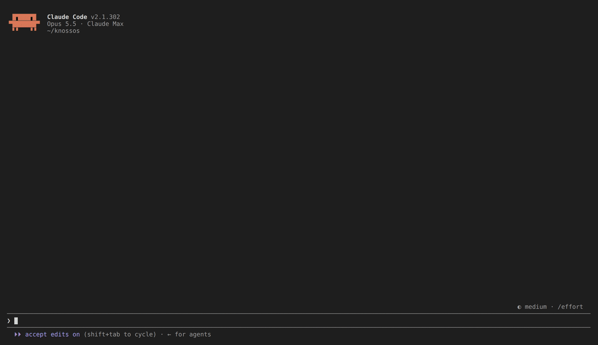
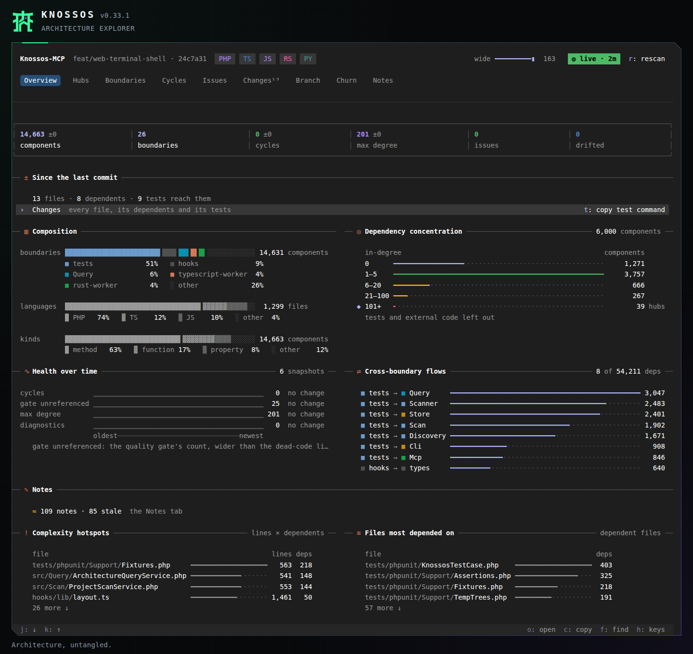

<div align="center">

# Knossos

**The labyrinth mapped once: on screen beside Claude Code, and in the notes your agent reads while it works.**

[](https://github.com/AraneaDev/knossos/releases)
[](https://aranea-development.nl/en/tools/knossos)
[](https://github.com/AraneaDev/knossos/actions/workflows/quality.yml)
[](https://github.com/AraneaDev/knossos/actions/workflows/quality.yml)
[](LICENSE)
[](https://github.com/AraneaDev/knossos)
[](https://github.com/AraneaDev/knossos/commits/main)
[](https://www.conventionalcommits.org/)
[](https://mcpobservatory.com/servers/github:AraneaDev/knossos/security)
[](#installation)

</div>

> **Knossos** (Κνωσός) is the Bronze Age palace at the heart of Minoan Crete, a complex so
> sprawling that Greek myth remembered it as the Labyrinth: the maze Daedalus built for the
> Minotaur, which no one could navigate without a thread to follow back out. Ariadne handed
> Theseus that thread.

**TL;DR:** Knossos scans a repository into a local graph of its components and the
relationships between them, each with the file and line that proves it. In Claude Code,
`/knossos` opens that graph as a live pane beside your session, and the agent gets a short note
at the moment it reads, edits or commits a file that matters: how much depends on it, which
rules bind it, and which tests reach it. The same graph answers 37 MCP tools and a CLI, for
Claude Code, Codex or any MCP client.

Facts that static analysis cannot prove are labelled with their confidence and origin.
Nothing in the scan installs dependencies, imports a module or boots a framework.

> **Status:** pre-release. Knossos is **not yet published to Packagist or any container
> registry**. The source is public on [GitHub](https://github.com/AraneaDev/knossos), so install
> from a checkout (see [Installation](#installation)). Image names such as `knossos:dev` are
> built locally by you; there is no `docker pull` to fetch them yet.

---



A Claude Code session: `/knossos` opening the pane, a walk through its
tabs and a search, then an edit, the band summing up the change, and its diff in Changes.

## Features

- **The pane**: `/knossos` opens the project's architecture beside your session on nine tabs
  (Overview, Hubs, Boundaries, Cycles, Issues, Changes, Branch, Churn and Notes), with a detail
  for every component and file, its blast radius as rings, and the route between any two
  components
- **The terminal pane**: `knossos` opens the same workspace fullscreen in your terminal, in a
  tmux split or a terminal of its own
- **The web client**: `knossos web` opens the same architecture workspace in your browser,
  with keyboard navigation, search, diffs and notes, without a Claude Code session
- **The band**: after a turn that edited files, one line above the prompt says how far the
  change reaches: the files, their dependents, the tests that reach them, the boundaries hit
- **Notes on components**: facts worth keeping, yours and the agent's, kept across rescans. The
  Notes tab shows them as a tree of where they live, says which went stale, and finds the one
  whose component you forgot. Your note wins over the agent's
- **Messages for the agent**: when the agent reads a heavily depended-on or policed file, edits
  one, ends a turn or makes a commit, it gets one short line about what that file or change
  carries. Each is said once and never blocks a tool call
- **37 MCP tools**: impact analysis, call sites, flows between components, cycles, hubs,
  dead-code candidates, untested code, change review, test impact, one file's context,
  snapshots and trends.
  Every tool except `server_info` has an equivalent CLI command
- **Evidence on every fact**: each relationship points back to a file and a line, and a path is
  only as confident as its weakest edge
- **4 languages**: PHP (with Laravel, Livewire and Symfony), TypeScript and JavaScript, Python and Rust,
  reconciled into one graph for a mixed repository
- **Architecture rules and budgets**: boundary policies that say which part may depend on
  which, and quality budgets checked against a reviewed baseline, with SARIF for CI
- **A live watcher**: one per project, shared by your sessions, rescans as files change, so the
  pane and the messages follow edits made by anyone
- **Session brief and routing skill**: each session starts knowing whether the graph is fresh,
  the project's rules and recorded notes, and which questions to bring to the graph
- **Safety model**: scanning never runs project code, the server reads only allowed roots, and
  a failed scan never replaces the last good graph

## Installation

You need PHP 8.3 or newer with JSON, PDO and PDO SQLite, Node 24 or newer, Python 3.11 or newer,
Composer 2 and Git. Cargo 1.82 or newer is optional and adds Rust scanning.

Clone the repository, then run the installer from the project you want to scan first:

```sh
git clone https://github.com/AraneaDev/knossos.git /absolute/path/to/knossos
cd /absolute/path/to/your-project
/absolute/path/to/knossos/tools/install
```

It installs the worker dependencies, creates the data directory `~/.knossos` with a roots file
that allows this project, scans it, and registers the MCP server with Claude Code at user scope.
Re-run it from another project to add that one.

Then install the plugin, which carries the pane, the messages, the session brief and the routing
skill. Its hooks run the `knossos` of the checkout that installed the plugin (falling back to
the one on your path), and must read the data directory your server uses:

```sh
ln -s /absolute/path/to/knossos/bin/knossos ~/.local/bin/knossos
knossos install-agent-plugin                                        # preview
knossos install-agent-plugin --data-dir="$HOME/.knossos" --execute
```

Start a new session. The brief appears at its start, and `/knossos` opens the pane.

- **Codex or another MCP client**: [Codex and other MCP clients](docs/agents/clients.md). The
  native pane and the messages are Claude Code hooks; every other client gets the MCP tools
  and can use the [web client](#web-client) to browse the graph.
- **No PHP on the host**: [Running Knossos in Docker](docs/operate/container.md).
- **When it does not start**: [installation pitfalls](docs/get-started/installation.md#installation-pitfalls),
  such as an unpinned data directory that gives the server and the plugin two different graphs.
- **Updating, removing, or trying the plugin for one session**: [the plugin guide](docs/claude-code/plugin.md).

## Quick start

The installer scanned your project. To scan another, allow it and scan it with the same data
directory the server uses:

```sh
export KNOSSOS_DATA_DIR="$HOME/.knossos"
knossos allow-root /absolute/path/to/project --execute
knossos scan /absolute/path/to/project
```

In a Claude Code session in that project, type `/knossos` to open the pane, then ask the agent a
structural question, such as "what breaks if I change `UserRepository`, and which tests would
tell me?". The routing skill sends it to the graph. A first scan with real output is in
[first scan](docs/get-started/first-scan.md#a-worked-example).

Outside a session, run `knossos` in the project for the same pane in your terminal, or
`knossos web` for it in your browser.

## The pane


Overview: what moved since the last scan, what this session touched, and how dependencies
concentrate.


Hubs: the most depended-on components, with the marked one's neighbourhood beside the list.


Cycles: each dependency cycle drawn as boxes, from its first member back to the start.


Changes: every file changed since the session began, its dependents, the tests that reach it,
and its diff.


Branch: whether this branch broke anything against main, then what it changed by boundary.


Notes: every note on the project, yours and the agent's, by where it lives.


The finder: `f`, a few letters of a name, and Enter opens that component.


The band: after a turn that edited files, how far the change reaches, with the pane shut.

Every tab, key and setting is in [the pane guide](docs/claude-code/pane/index.md).

## Terminal pane

Keep the architecture next to your work in a terminal, such as a tmux split:

```sh
cd /path/to/your-project
knossos
```

It is the same nine tabs, drawn in the terminal, with the mouse and the keys of the pane.
`Ctrl-C` quits, and so does `q` unless the pane gives `q` to a press: on a project that
was never scanned, `q` starts the scan. It shares the project's server with `knossos web`, so a browser open
on the same project shows the same pane. See [the terminal guide](docs/guides/terminal-pane.md)
for the options, the keys and what differs from the browser.

## Web client

Browse your project's architecture in a browser while working in Codex, another editor,
or outside an agent session:

```sh
cd /path/to/your-project
knossos web
```



The local server opens your browser with the same nine tabs, finder, component and file
details, blast radius, diffs and notes as the native pane. Click a tab or use its number;
press `f` to find a component. The Changes tab follows uncommitted work against the last
commit, without needing a Claude Code session.

Keep the command running while you use the client; `Ctrl-C` stops it. To name another project
or choose a port without opening a browser automatically:

```sh
knossos web /path/to/your-project --port=8123 --no-open
```

Use the printed address, including its token. See [the web client guide](docs/guides/web-pane.md)
for editor integration, keyboard controls, bookmarks, installing it as an app, and the
differences from the Claude Code pane.

## What your agent gets

Four messages, each one line, each said once at the moment it helps: after a Read of a heavily
depended-on or policed file, after an edit of one the Read missed, at the end of a turn that
edited files (the boundary violations it introduced and the tests that reach its changes), and
after a commit, on what the session's changes leave behind:

```text
knossos: this session's changes carry 1 changed file no test reaches (src/Kernel.php); 1 dependency cycle new since the session began (Router → Kernel). Check them before you push.
```

Before an edit, `file_context` gives one file's boundary and the rules that bind it, its
dependents, the tests that reach it and its latest commits, in one call instead of a grep for
its callers. Every message and its limits are in [messages for the model](docs/claude-code/model-messages.md).

Over MCP, in any client, the 37 tools answer questions such as:

- What depends, directly or transitively, on `UserRepository`?
- What are the exact call sites of `ScannerClient::scan`?
- How can a checkout request reach invoice generation?
- Which relationships cross a declared boundary policy?
- Which test files exercise the blast radius of this diff?
- Which files and functions does no test reach?
- Where would a refunds feature fit the existing structure?

Each group of tools has its own guide, linked from the [docs index](docs/README.md), and every
schema is in the [MCP tool reference](docs/reference/mcp-tools.md).

## CLI and CI

Every query is also a CLI command, with `--json` for scripts. A project is named by a path
inside it or by its ID, and the CLI reads the same graph as the server (`~/.knossos` after
`tools/install`):

```sh
knossos impact-analysis . 'App\Billing\Invoice'
knossos review-diff . --base-ref=main --policies=architecture-policies.json
knossos quality-gate . <baseline-snapshot> --budgets=knossos-budgets.json --sarif --json
knossos dead-code .
knossos diagnostics . --severity=error
knossos check-architecture .
knossos watch /absolute/path/to/project
```

Exit code `0` means every evaluated gate passed, `1` that a gate failed, and `2` that the result
could not be evaluated. See [CI and editor integration](docs/operate/ci-editor-integration.md),
[rules and budgets](docs/guides/architecture-rules.md), [watch mode](docs/operate/watch-mode.md)
and the [CLI reference](docs/reference/cli.md).

## Supported languages

| Language                                         | Extraction                                                                                         | Framework enrichment                                                                         |
| ------------------------------------------------ | -------------------------------------------------------------------------------------------------- | -------------------------------------------------------------------------------------------- |
| PHP 8.3 or newer                                 | Declarations, inheritance, calls, construction, types, injection                                   | [Laravel, Livewire](docs/languages/php-laravel.md), [Symfony](docs/languages/php-symfony.md) |
| TypeScript/JavaScript                            | Compiler symbol resolution, imports, calls, types, project references, Vue/Svelte/Astro components | [Next.js, NestJS, React, Vue, stores, endpoints](docs/languages/typescript.md)               |
| Python 3.11 or newer                             | Standard-library AST in an isolated interpreter; manifests, packages, calls, routes                | [FastAPI, Django, Flask, Celery](docs/languages/python.md)                                   |
| Rust 1.82 or newer, optional on a native install | `syn` parsing; Cargo manifests, cross-file impls, routes; never invokes cargo/rustc                | [Details and limits](docs/languages/rust.md)                                                 |

Mixed repositories reconcile into one graph. Other scanners plug in as isolated worker
processes through the [scanner SDK](docs/reference/scanner-sdk.md).

## Safety model

- Scanning never installs dependencies, executes project code or boots a framework. Workers are
  supervised and resource-capped, and their output is untrusted until it passes validation.
- The allow-list is a security boundary. `serve` refuses to start without a root, and Knossos
  never writes the roots file during normal operation: only `tools/install` and
  `knossos allow-root --execute` do, so widening it stays a deliberate act on disk.
- The database is derived and rebuildable, and source mounts stay read-only.
- The Git-backed tools run `git` with repository-controlled hooks, pagers and drivers forced off.
- MCP stdio is the recommended transport. The loopback-only HTTP profile has its own
  [threat model](docs/operate/http-threat-model.md).
- A failed scan is never activated: the last complete scan stays the graph you query. See the
  [fault recovery matrix](docs/operate/recovery-matrix.md).

## Development

One versioned quality profile runs locally, in Git hooks and in CI:

```sh
tools/quality-container fast
tools/quality-container full
```

`fast` covers linting, static analysis, formatting and the whole test suite. `full` adds
security audits, coverage floors, performance budgets, mutation score and supply-chain checks.
See [quality gates](docs/contribute/quality.md), [how the mod is built](docs/contribute/mod-internals.md)
and [CONTRIBUTING.md](CONTRIBUTING.md) for the workflow, the Conventional Commit prefixes that
drive releases, and how to add a language scanner.

## Further reading

- [The documentation index](docs/README.md): which page answers which question
- [What a dependency graph finds that your coding agent misses](https://tim-schipper.nl/en/blog/dependency-graph-coding-agents)

## License

[MIT](LICENSE).

## Links

- [Tool page](https://aranea-development.nl/en/tools/knossos)
- [Model Context Protocol](https://modelcontextprotocol.io/)
- [Claude Code plugins](https://code.claude.com/docs/en/plugins)
- [Changelog](CHANGELOG.md)

---

Built by [Tim Schipper](https://tim-schipper.nl/en) and released as open source under
[Aranea Development](https://aranea-development.nl).
