# The Claude Code pane

The Knossos plugin carries a mod for Claude Code: a module of function hooks
that puts the graph on screen while a session works. You get three things:

- **The band**, one line above the prompt after a turn that edited files: what
  the turn changed and how far that reaches.
- **The pane**, which `/knossos` opens: the project's architecture on eight
  tabs, with a detail for every component and file.
- **The live watcher**, which rescans the project as files change, so the band
  and the pane follow the code whoever edits it.

The mod also tells the model a few facts at the moment they help. Those notes
are on their own page: [notes for the model](agent-notes.md).

The mod never blocks an edit, never starts a turn on its own and never scans
inside a hook. When something it needs is missing, it stays quiet.

## Before you start

The pane needs three things, and shows nothing useful without them:

1. The plugin, installed from the checkout that runs your Knossos server. See
   [the plugin page](plugin.md).
2. A `knossos` binary the hooks can find, and the data directory your server
   uses. The plugin page covers both.
3. A scanned project inside an allowed root. See
   [your first scan](../get-started/first-scan.md). The pane can ask Claude to
   scan the project and can allow a refused root for you, both only on your
   press (see [no graph yet](#no-graph-yet)).

## The band

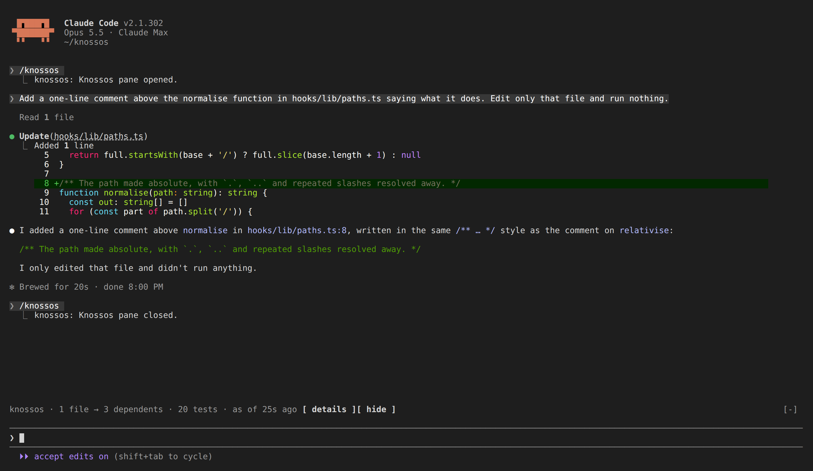

After a turn that edited files, one line above the prompt sums up the turn:

```text
knossos · 2 files → 37 dependents · 4 tests · as of 12s ago · reaching core, http +1
```

Read it left to right:

| part                      | what it counts                                                         |
| ------------------------- | ---------------------------------------------------------------------- |
| `2 files → 37 dependents` | the files the turn changed, and the files that depend on them          |
| `1 deleted`               | files the turn deleted, when there are any                             |
| `1 policy violation`      | boundary-policy violations the turn introduced; the band turns red     |
| `4 tests`                 | the test files that reach the change                                   |
| `as of 12s ago`           | how old the figures are; it keeps counting while the band is on screen |
| `reaching core, http +1`  | the two boundaries holding the most dependents, then how many more     |

When the project declares boundaries, only declared ones are named. The
boundaries come last, so a narrow terminal cuts them first.

While a scan runs, the band says `knossos · scanning…` and keeps the last
figures with their age (`· last: … · as of 2m ago`). A scan that fails says
`knossos · scan failed`, with the reason when there is one and the age of the
figures it kept.

`[ details ]` opens the pane. `[ hide ]` hides the band for the rest of the
session.

When the project's root is not allowed, the band names it instead of figures
(`knossos · not allowed: my-project`). The command that allows it does not fit
a band, so `[ copy ]` copies it whole:

```sh
KNOSSOS_ROOTS_FILE='/home/me/.knossos/roots.json' knossos allow-root '/home/me/my-project' --execute
```

`[ details ]` opens the pane, which offers to run it for you after asking.

## Open the pane

`/knossos` opens the pane and closes it again. `/knossos inspect <component>`
opens it on one component's detail. Set `openPaneOnStart` (see
[settings](#settings)) to open it whenever a session starts.

Right after a reload of the plugin, Claude Code can refuse to register the
command until a session is bound. The mod retries for about a minute, then at
the end of each turn.

Every time the pane opens it reloads the dashboard, so it never shows old
figures as current.

### The header

The first row names the project in bold, then where the checkout stands (the
branch and the short commit, dim; the commit alone on a detached head, as in
the stills; nothing outside git), the project's languages as small chips, each
in its own colour, and at the right edge the width gauge and the status pill.

The width gauge says which layout the pane is in (see Layouts by width), where
its width stands within that layout's span, and the width the next layout
starts at: `medium ━━━━━━▮─── wide  118/131`. On the widest layout it says
the width alone. With less room it shrinks to `118 · medium`, and it is the
first thing the header gives up.

While the live watcher keeps the graph current, the pill starts with a dot
that breathes for a few seconds when a scan lands and then sits still; while a
scan runs, a spinner turns in its place. Nothing in the pane moves while the
graph is idle.

| pill                  | meaning                                                                         |
| --------------------- | ------------------------------------------------------------------------------- |
| `● fresh 4s`          | the snapshot matches the files; the age is the snapshot's                       |
| `● stale 38m`         | files changed since the snapshot                                                |
| `● live · 7s`         | the live watcher keeps the graph current; the age is since the graph last moved |
| `● following · 7s`    | another session's watcher leads for this project                                |
| `● scanning…`         | a scan is under way                                                             |
| `● refresh failed 2m` | a reload failed; the figures on show are the ones from before                   |
| `● scan failed`       | a rescan failed; the reason stands beside the pill                              |

When the leading watcher stops answering, the pill says
`another session's watcher is stuck` beside it. While another process holds the
scan lock (the model's `scan_project`, `knossos scan` from a shell), the pill says
`scanning…` with `another process is scanning (pid 1234)` beside it, and the pane
offers no rescan of its own until that scan ends. As the pane narrows, the
width gauge goes first, then the language chips, then the commit, the branch
and the reason.

In a detail, the first row is the way back instead: `knossos › Hubs ›
ResultEnvelope`.

The second row is the tab bar. The open tab stands on the theme's selection
colour. Issues and Changes carry their counts as superscript badges
(`Issues³`, `Changes¹`), and Branch carries what it found. Where the names do
not fit, and always on a narrow pane, the other tabs show only their digit.

### Layouts by width

The pane uses all the room it has, in one of three layouts by the columns of
its body:

| width               | layout                                                                             |
| ------------------- | ---------------------------------------------------------------------------------- |
| narrow, below 80    | one column; each card is a title set into a rule, its rows from the edge           |
| medium, 80 to 130   | one column of cards, their rows two cells in; tables add columns, such as the file |
| wide, more than 130 | a grid of cards, two columns to a row, the cards of a row drawn equally tall       |

Every card is its title in Claude's orange, set into a rule across the card,
with its note at the rule's end; no box closes round it.

On a wide pane, Hubs, Cycles, Issues, Changes, Branch and Churn become master
and detail: the tab takes the left 55 percent and the marked row's detail
stands beside it. Moving the marker looks the new row up after a short pause,
so holding `j` is one lookup. A row with nothing to show (a boundary, a
chart's bar) leaves the tab alone. On a narrower pane, `o` opens a row's
detail in place of the tab.

Lists size themselves to the pane's height, up to 28 rows each. A list cut
short ends in `24 more ↓` (and `3 above ↑` once the marker has moved down it),
and moving the marker scrolls it. Each part of that line is a button that moves
the marker onto the nearest row it counts, the last above or the first below,
and the list follows. A list the marker does not walk (the tests that reach the
changes) keeps it as text. A pane too short for even a few rows scrolls as a
whole.

### Keys

Every key is also a button, so a click works as well. The footer bar at the
bottom of the pane lists the keys that do something in the view on show:
moving about on the left, what you can do to the marked row on the right. For
a moment after an action the footer says what it did (`✓ copied StableId`,
`✓ opened in editor`, `✗ code exited 1 · path copied`). `h` lists every key, one
a line, in place of whatever is open; `h` or `x` closes the list, and so does
any other press, a tab or `f`, which then does what it does:

| key         | what it does                                                                                           |
| ----------- | ------------------------------------------------------------------------------------------------------ |
| `1`–`9`     | switch tabs (or click one)                                                                             |
| `j` `k`     | move the `›` marker (or Tab, the arrows, or a click)                                                   |
| `o`         | open the marked row: a component or a file shows what depends on it, an Overview bar the tab it counts |
| `e`         | open the marked row's file in your editor                                                              |
| `b`         | back from a detail or a route                                                                          |
| `c`         | copy the marked row's full name or path                                                                |
| `q`         | ask Claude about the marked row; your press sends the prompt                                           |
| `t`         | on Overview and Changes: copy the command for the tests that reach this session's changes              |
| `d`         | list the files drifted since the snapshot, or hide them                                                |
| `u`         | on Overview and Changes: list only the changed files no test reaches, or every file again              |
| `l`         | on Boundaries: move the marked cell to the next boundary the marked one depends on                     |
| `f`         | open the [finder](#the-finder)                                                                         |
| `p`         | in a component's detail: draw a [route](#a-route-between-two-components) to another component          |
| `m`         | in a component's detail: add a [note](#a-note-on-a-component)                                          |
| `n` `s` `x` | on Hubs: narrow the list, sort by in, out or cross degree, clear the narrowing                         |
| `n` `s` `x` | on [Notes](#notes): narrow by text, show yours, the model's, the stale, missing or flagged, clear both |
| `m` `w` `g` | on Notes: edit your note or adopt the model's, remove a note, flag the model's note for it to check    |
| `r`         | rescan the project now, fresh or not                                                                   |
| `a`         | allow a refused root (asks first)                                                                      |

Escape cannot be caught by a pane (it hands the keyboard back to the prompt),
so `b` is the way back.

**Opening a file.** Every `file:line` the pane shows is a link. A ctrl- or
cmd-click opens it as a link in one of Claude's replies would. A plain click,
or `e`, runs the `editor` [setting](#settings), `code -g {file}:{line}` unless
you set another, which VS Code and its forks answer (`idea --line {line}
{file}` for IntelliJ, `"/opt/Sublime Text/subl" {file}:{line}` for a program
whose path has spaces). When the command fails, the pane copies `path:line` to
your clipboard, the footer says how it failed (`✗ code did not start · path
copied`), and a toast names the command it ran and where to set another. A
terminal editor from `$EDITOR` cannot be started this way, since it needs a
terminal of its own.

**Asking Claude.** `q` submits one prompt for the marked row. For a component
or a file:

```text
Using the Knossos graph, what depends on <canonical name> and what would break if I changed it?
```

On Cycles it asks how to break the cycle, on Boundaries what the boundary's
dependencies are for, and on Overview about the bar the marker rests on. The
mod submits a prompt in two places only, each on your press: this one, and the
request to scan a project that has no graph yet.

### Colours

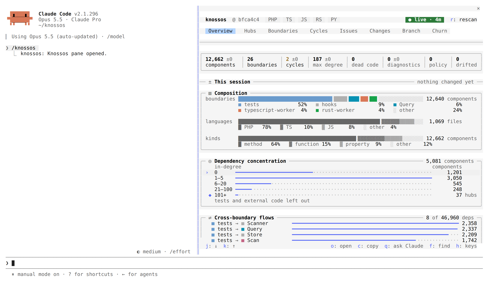

The pane draws in your Claude Code theme's own colours, so it follows a dark,
light, daltonized or ANSI theme and a theme you pick in `/config`. Colour marks
what matters first, and gives the pane its life within the theme:

- Each boundary keeps one of seven colours wherever it appears, the largest
  boundaries first and declared ones before inferred ones. The colour sits on
  a small `■` swatch, a bar or a frame, never on a word. Red is never a
  boundary's colour.
- `success`, `warning` and `error` mean a status only, always beside a glyph
  or a word that says it. On this pane red means an error or a policy
  violation.
- The marked row stands on a faint tint across its card, with its `›` kept for
  a terminal that draws no backgrounds.
- Card titles stand in Claude's orange, each stat tile's figure in its own hue
  while nothing is wrong with it, each language chip in its own colour, and the
  in-degree histogram runs cool to hot, from the fewest dependants to the hubs.
  None of these hues is a boundary's.
- Everything else is neutral: names and figures in the text colour, labels and
  units dim, bar tracks fainter still.

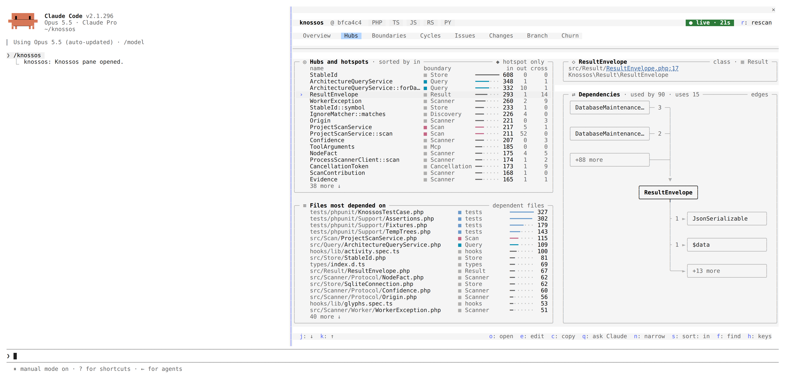

When a new snapshot lands, the rows whose figures it changed are drawn on a
cool ground for about three seconds, and the Overview's bars grow in.

## Overview

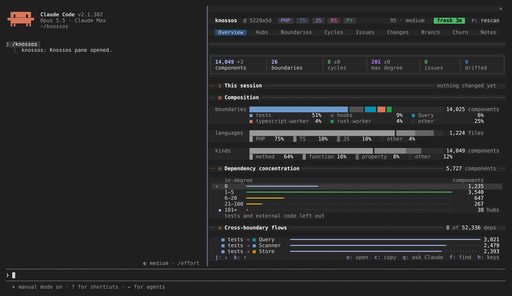

Overview measures the project; the lists are on the other tabs.

**The stat tiles** across the top: components, boundaries, cycles, max degree,
dead code, diagnostics, policy and drifted. Beside a figure, how it moved since
the snapshot retained before this one (`▲1,788`, `▼1`, `±0`). A figure that
deviates is coloured: cycles and diagnostics above zero in the warning colour,
policy violations in the error colour, drifted files in the accent. The cycles
figure counts cycles between types only; the ones that stay inside one type
show on the Cycles tab alone. A tile
draws its trend as a sparkline when it has room and five or more snapshots
move. `dead code` counts the candidates the Issues tab lists and has no delta.
The `drifted` label is a button that lists the drifted files, as `d` does. The
labels of the other figures that count a list are buttons too, each opening the
tab that lists them with the marker on the first item: `components` opens Hubs,
`boundaries` opens Boundaries, `cycles` opens Cycles, and `policy`,
`diagnostics` and `dead code` open Issues on their first violation, diagnostic
or candidate. When Issues lists none of what the figure counts (a policy total
whose violations are all `+N not listed`, say), the tab opens at its top with
the marker on its first row, whichever kind that is. At zero there is nothing to list, and the label is plain. `max
degree` is a single figure, so it is always plain.

**This session**: the session's scans as a row of dots, how many files it
touched, their dependents and the tests that reach them (within six hops), with
a warning when no test does. A warning about files no test reaches is a button: it opens Changes
with only those files listed, as `u` does. The marker starts on the way to the
Changes tab. `t` copies the tests' command. Before anything changed it is one
line, `nothing changed yet`.

**Composition**: what the project is made of, as a 100 percent stacked bar per
dimension. Components by boundary, each in its colour, the five largest named
and the rest as `other`. Files by language and components by kind, in one
neutral ink told apart by texture (`█ ▓ ▒`, and `░` for the rest). The total
stands right-aligned beside each bar, every part's share in a legend under it.

**Dependency concentration**: how many components have how many dependents, in
five buckets of in-degree: `0`, `1–5`, `6–20`, `21–100` and `101+`. The top
bucket is marked `◆` and counted as hubs. It counts every component the hub
ranking could hold, tests and external code left out, and the title's total
ends in `+` when that count was cut short. `o` on a bucket opens Hubs narrowed
to it.

**Health over time**: one row each for cycles, `gate unreferenced`, max degree
and diagnostics, every row a small chart on its own scale over the same
snapshots, oldest on the left. The newest value stands at the right with its
range, or `no change`. It appears from five retained snapshots on.
`gate unreferenced` is the quality gate's count of components nothing
references, which is wider than the dead-code tile, so the two differ by
design.

A snapshot with more than 300,000 rows in one table is not read whole, so only
what a count says is kept of it: components, relationships and diagnostics.
Its cycles, `gate unreferenced` and max degree are not counted, those rows are
left out, and the card says so in a line of its own, with the table and its
rows when it is the live graph. The card then shows even without five
snapshots, so a large graph is never silently without one.

**Cross-boundary flows**: the strongest dependencies from one boundary to
another, `■ tests → ■ core` with a bar and the count. A pair a declared policy
forbids has its bar in the error colour and says `× forbidden`. `o` on a flow
opens its cell on Boundaries.

On a tall pane, the rows left over go to two more lists: the complexity
hotspots and the files most depended on, each a link to its file.

**Notes**: one line, how many notes the project holds and how many need you
(`142 notes · 3 missing · 5 stale · 1 flagged`). `o` on it opens the
[Notes tab](#notes) on the most pressing group: the missing, else the stale,
else the flagged.

The marker walks the way to Changes, the buckets, the flows, then the notes.

## Hubs

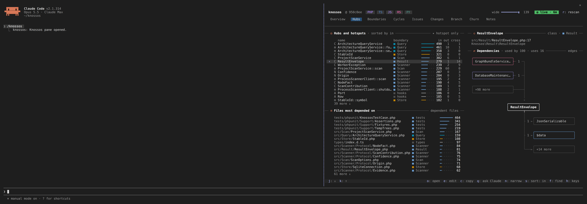

**Hubs and hotspots** lists the components most depended on, one row each,
with its boundary and three degrees:

| column  | meaning                                                     |
| ------- | ----------------------------------------------------------- |
| `in`    | dependencies on it from other components                    |
| `out`   | its dependencies on other components                        |
| `cross` | those of its dependencies, in or out, that cross a boundary |

The bar follows the sorted column, and the title says which (`sorted by in`).
`◆` marks a hotspot that is not also a hub. Methods read `Class::method`. The
list holds the fifty most depended on, and the note says `partial` when the
walk that ranks them stopped at its time limit.

Beside it (below it on a narrower pane), **Files most depended on** lists files
with how many files depend on each.

| key | what it does                                                               |
| --- | -------------------------------------------------------------------------- |
| `s` | sort by in, out or cross degree in turn                                    |
| `n` | narrow both lists to names that hold what you type; Enter keeps the filter |
| `x` | clear the filter, or the in-degree range an Overview bucket set            |
| `o` | open the marked component or file as its detail                            |
| `e` | open the component's file at its declaration                               |

Opened from an Overview bucket, the list holds only the hubs in that range
(`in-degree 101+ · 26 listed of 27`). The bucket may count more than the list
holds.

Rest the pointer on a name (where the surface has a pointer) to see a card
without opening anything: the name and boundary, how many files depend on it,
a component's in- and out-degree, and the three files that depend on it most.

On a wide pane the marked row's detail stands beside the lists, as in the
still: here `ResultEnvelope`, used by 89 and using 15.

## Boundaries

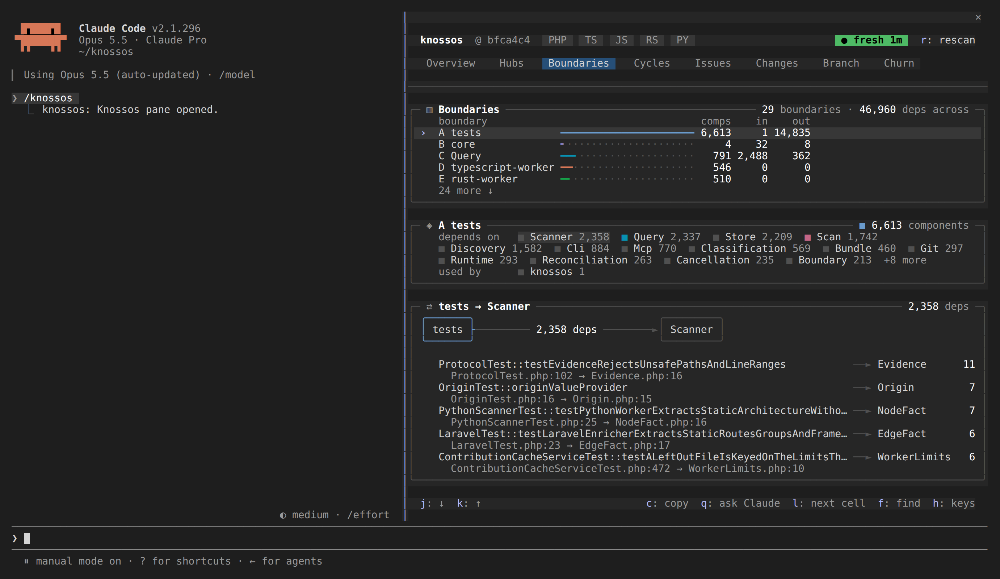

**The heat map** shows how much each boundary depends on each other one. Rows
are where a dependency starts, columns where it lands. The axes are lettered,
and the row labels spell the letters out.

- A cell's shade is the number of dependencies on a log scale of the busiest
  cell, in four steps of the accent colour. The legend under the map reads
  `fewer … more deps`.
- A faint `·` means nothing crosses.
- `×` in the error colour marks a pair a declared policy forbids while nothing
  crosses it. Once something does, the cell is an error tile.
- The marked cell is a solid tile in the text colour.

On the terminal the map is a grid of solid tiles in your theme's colours.
Elsewhere it is drawn as shades from `░` to `█`. With rows to spare, each cell
grows to two or three rows tall and stays square.

**Per boundary** lists each boundary with `comps` (its components), `in` (the
dependencies from other boundaries into it) and `out` (its dependencies into
other boundaries). A component counts in one boundary, the one the pane labels
it with.

`j` and `k` mark a boundary, and two cards spell it out:

- **The marked boundary**: what it depends on and what depends on it, each
  with its count, and the boundaries a policy forbids it to use.
- **The marked cell**: the boundary's row, in the column of what it depends on
  most. A box for each boundary, the arrow between them with how many
  dependencies run that way, and under it the five component pairs that make
  up most of them, each side named as the rest of the pane names it (a method
  by its class and name), with a line under each pair saying where its two
  sides are declared (`views.py:12 → Client.php:40`).

Past twelve boundaries a heat map can no longer be read, so the tab draws
none. **Boundaries** lists every one with the same columns, its note counting
them and their dependencies, and the marked boundary and its cell sit beside
it on a wide pane, under it otherwise. The dashboard holds up to a hundred
boundaries. However many boundaries the marked one touches, each of its lines
takes at most three rows and counts the rest (`+40 more`).

`l` moves the cell to the next boundary the marked one depends on, as does a
press on one of those boundaries. A boundary opens nothing; `c` copies its
name and `q` asks Claude what its dependencies are for.

## Cycles

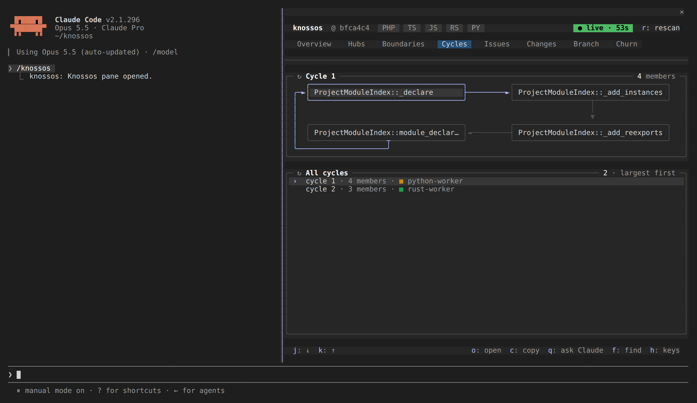

**Cycle 1** draws the marked dependency cycle as a serpentine of boxes, one box
per member: the first row left to right, the next right to left, an arrow from
each member to the next, and a return edge labelled `back to the start`. Its
note says how many members it has.

- A cycle that spans boundaries frames each box in its boundary's colour and
  marks each hop that crosses a boundary with `╫` (`╪` on a vertical hop) in
  the warning colour.
- The marked member's box is framed in the accent.
- A long cycle folds its middle into one `… 4 more …` box: past six members on
  a narrow pane, ten on a medium one and sixteen on a wide one. `o` on the fold
  unfolds it.
- Members the dashboard did not list (it lists forty per cycle) close the loop
  as one `+N not listed` box.
- Below 50 columns, the drawing becomes the chain as text and a member a row.

**All cycles** lists the ten largest, each with its member count and the
boundary most of its members are in. After them, under a `Within one type` line,
come the cycles whose members all belong to one class, such as a tree walk whose
methods call each other: each is named by its type (`Walk · 3 members`) and
draws and opens like any other. The note counts them apart (`1 · 2 within one
type`); only the cycles between types count towards the tile, the toasts, the
commit note and the quality gate.

`j` and `k` walk the members box by box in reading order, then on to the next
cycle. `o` opens a member, `c` copies it, and `q` asks Claude how to break the
cycle.

## Issues

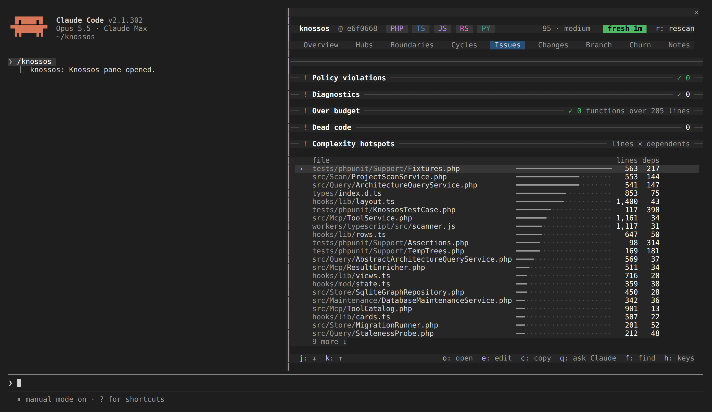

The Issues tab on this repository: a card per kind of finding, each headed by its count, and the complexity hotspots below them.

Issues gathers what needs fixing, one card each, in the order a pane this wide stacks them:

- **Policy violations**: each declared policy violation, with the offending
  file and line.
- **Diagnostics**: the scan's errors and warnings, the first twenty, then
  `+N not listed`; notes are counted, never listed. Each row ends in its path
  from the project root and its line, cut from the start where the row is
  short, then the scanner or enricher that recorded it (`· typescript`, or
  `· source unknown`). A message longer than one line ends in `…`. The marker
  walks them: `o` opens a diagnostic's file and `e` opens it at its line. A
  diagnostic about no file only takes the marker: `o` and `e` do nothing on it.
- **Over budget**: files with a PHP function longer than the
  `max_php_function_lines` budget in `maintainability-budgets.json`, with how
  many functions are over and the longest. Its note names the rule
  (`functions over 205 lines` in this repository) and reads `✓ 0` when no file breaks it, and
  `no maintainability-budgets.json` without the file.
- **Dead code**: the first fifty dead-code candidates. `◇` marks one only tests
  reach. See [dead-code candidates](../concepts/dead-code-candidates.md).
- **Complexity hotspots**: files ranked by their lines times their dependent
  files, with a bar of that product beside the two figures.

A card with nothing to list is one line (`── ! Policy violations ──── ✓ 0 ──`).
The tab's badge counts violations, errors and warnings. `o` on a hotspot or a
file over budget opens the file's detail, and `e` opens the file at its
longest function.

## Changes

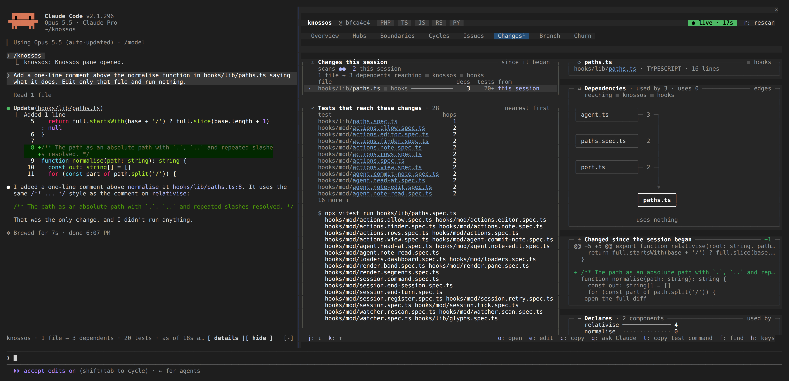

Changes lists everything that changed in the project since the session began,
whoever changed it: the session's own turns and subagents, your editor, a
checkout.

**Changes this session** heads with the session's scans as a row of dots,
oldest first: in the accent for a scan that took in the session's own changes,
dim for one that took in changes made outside it, then how many of each. Under
it, the files, their dependents and the boundaries they reach, and in the
warning colour how many files no test reaches.

`▲ N files no test reaches` counts the files that knossos knows no test reaches.
The count is a button, as is `u`. It lists only those files, the marker on the
first, and the line then reads `▲ N files no test reaches · showing only these`.
Pressing it again, `u`, or the `show all files` row under it lists every file,
the marker kept on its file. The list shows every file again after a `/clear`,
and once no file is left that no test reaches. `▲ N policy violations
introduced` is a button that opens Issues on its first violation. When no test
reaches the changes at all, the tests card's `▲ no test reaches these changes`
lists the files no test reaches in the same way.

Each file row has:

| column   | meaning                                                                                     |
| -------- | ------------------------------------------------------------------------------------------- |
| mark     | `+` added, `−` deleted, blank for a changed file                                            |
| boundary | the boundary the file sits in                                                               |
| `deps`   | how many files depend on it, with a bar                                                     |
| `tests`  | how many test files reach it; `▲ none` when none does, `20+` at the cap, blank when unknown |
| `from`   | `this session` or `outside`                                                                 |

**Tests that reach these changes** lists them nearest first, then the command
that runs them, chosen from their paths:

| test files                     | command                                                            |
| ------------------------------ | ------------------------------------------------------------------ |
| `*Test.php`                    | `vendor/bin/phpunit <file>`, or `--filter '(A\|B)'` for several    |
| `*.spec.*`, `*.test.*` scripts | `npx vitest run` or `npx jest`, as the nearest `package.json` says |
| `test_*.py`, `*_test.py`       | `python -m pytest`                                                 |
| `*_test.go`                    | `go test` per package                                              |
| Rust files                     | `cargo test`                                                       |

A script whose runner the project does not make plain is left out of the
command. Several runners are joined with `&&`. When your session sits below
the project's root (inside an ancestor project), the command starts with
`cd <project root> &&`. `t` copies it.

`o` opens the marked file's detail, with its [diff](#the-diff-since-the-session-began),
and `e` opens the file. On a wide pane the marked file's diff stands beside the
list as text, cut short; its last row, `open the full diff`, opens the same
detail as `o`, where the diff is drawn across the pane.

### Where the list comes from

While the live watcher runs, the list comes from the scan ledger, which every
scan of the project writes to, read again after each scan. It holds at most
200 files and 50 tests, and the dot row the newest 60 scans.

When the ledger cannot reach back to the session's start, the tab says so,
lists what changed since the oldest point it still answers for, and puts that
time in its note (`since 2026-10-04 09:14`). A session that began among the
older scans the ledger keeps merged lists what changed after it and says its
start is approximate.

With no watcher (switched off), the tab adds up what
the session's own turn briefs reported, and says so. That list keeps at most
500 files and 500 tests, and says `partial` past that.

### `this session` or `outside`

A shell command (`sed -i`, `git mv`, a formatter's `--write`) edits files as
surely as the edit tools do, so whose a change is depends on when it was made.
The mod keeps when each of the session's tool calls ran, in the main loop and
in every subagent. A file is `this session`'s when the session's Edit, Write or
NotebookEdit wrote it, or when a scan took it in while one of the session's
calls was running.

Calls that only read or wait do not count: Read, Grep, Glob, `file_context`,
and Agent, AskUserQuestion, TaskOutput, TaskStop, Monitor, SendMessage and the
plan-mode tools. A change made while the session waits on someone is yours.

Two consequences follow. A change you make in your editor while one of the
session's calls runs counts as the session's. A command started in the
background counts only while the call that started it runs.

A session continued in a new process (`claude --continue` or `--resume`) reads
its start back, so Changes and the diffs still count from where it began. Which
changes its tools made is known only to the process that saw them, so in a new
process the earlier ones read `outside`.

## Branch

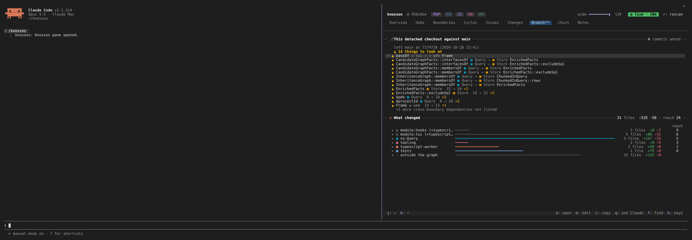

Branch answers two things at a glance: what this branch changed against its
default branch, and whether it broke anything.

**The first card** names the branch against its default branch, how many
commits ahead it is, and where it left (`left main at fd13714`). Git finds the
default branch (the one `origin/HEAD` names, else `main` or `master`) and the
merge base, locally. The tab compares against a retained snapshot taken at that
commit, else the nearest one before it, and then says how many commits earlier
that was. When none near the merge base is retained, it says so in the warning
colour, and compares against the oldest snapshot after the merge base,
saying how many of the branch's commits that snapshot already holds, since
their changes do not show. On the default branch itself, or without git, the
card says that instead.

Under that, the verdict. When nothing broke it is one line:
`✓ no new cycles ✓ no new crossings ✓ no hubs grew ✓ no dead code ✓ no violations` (the last only
when the project declares policies). When something did, it says how many
things to look at, then a row for each, the worst first: policy violations,
new cycles, dependencies newly crossing from one boundary into another, hubs at
least ten depend on that more depend on than before (`20 → 31 +11`), and new
dead code. Past the first eight of a kind it says how many more are not listed.
Every finding opens its component. The comparison is read when the tab opens
and again for each new snapshot.

**What changed** totals the files the branch's commits touched since the merge
base, their lines and how many files their changes reach
(`7 files +45 −6 · reach 61`), then lists them by boundary: a row for each,
with a bar for its lines, its files, its lines and the files it reaches, each
counted once. The boundary that reaches most comes first, the files outside the
graph (docs, lockfiles) last; files the graph holds that no boundary claims
form a row of their own, `no boundary`. `o` on a boundary unfolds its files under it,
each with its lines and dependents, and `o` on a file opens it. It needs no
snapshot, so it still lists when the comparison cannot be made. Uncommitted
edits are not in it: the Changes tab has those.

## Churn

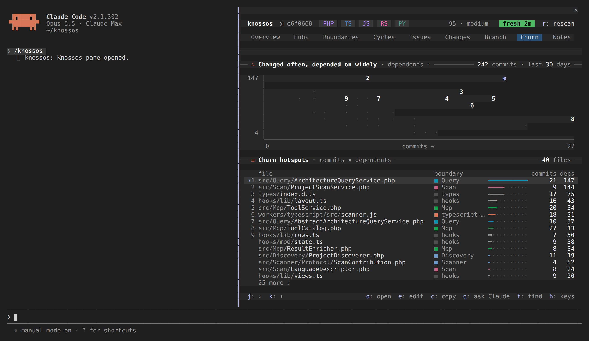

Churn ranks the files changed most often in the last thirty days that much of
the project depends on. A file's score is its commits in the window times the
files that depend on it.

**Changed often, depended on widely** is a scatter of every listed file:
commits across, dependents up on a log scale from the fewest listed to the
most. The nine highest scores are drawn as their rank digit, and the marked
file as the accent dot. The note says how many commits were read.

**Churn hotspots** is the ranked list, at most forty files: each with its rank
(for the top nine), its boundary, a bar for its score, its commits and its
dependents. `o` opens a file's detail.

The tab reads one `git log`, at most 500 commits and three seconds. A log too
large to read whole is read again over the last 50 commits and marked cut. It
is read again when the checkout moves to another commit, not on every scan.
Without git the tab says so.

## Notes

The Notes tab is every note in the project, yours and the model's, as a tree of
where each lives, with the ones that need you first.

**Needs you** lists a note on a name the graph no longer holds (`▲`: its
component was renamed or moved, and the note sits on the old name) and a model
note you flagged for the model (`?`). They stay in the tree as well.

**The tree** below it has a row for each boundary (its swatch, its name and how
many notes it holds), the folders inside it, and their notes. The boundary
holding the newest note starts open and the rest folded; folders start open. `o`
on a boundary or a folder folds or unfolds it. A note's row names its component
(a file note by its path), who wrote it (`you` or `model`), its kind when it is
not a plain note, the first line of its text and the day it was written; a stale
model note, one whose files changed since it was written, ends in `≈`. The
card's note counts them: `142 notes · 3 missing · 5 stale · 1 flagged`.

**Under the tree**, the marked note whole: where it lives (its file and
boundary), who wrote it and when, why it needs a look, and its text.

`n` narrows the tree by text (part of a name or of a note; Enter keeps it), and
while it does, every group is open so every match shows. `s`
shows every note, yours, the model's, the stale, the missing or the flagged in
turn, and `x` clears both. On the marked note:

| key | what it does                                                                                                       |
| --- | ------------------------------------------------------------------------------------------------------------------ |
| `o` | open its component's detail; on a note on a missing name, open the finder on the old name to pick where it belongs |
| `m` | edit your note, or adopt the model's: the detail opens with its text in the editor, and saving writes it as yours  |
| `w` | remove it, yours or the model's, after asking                                                                      |
| `g` | flag the model's note for the model to check, with a reason if you give one; on a flagged note, take the flag back |
| `v` | on a stale model note: it is still true. It rests on its files as they are now; its text, date and flag stay       |

A note you adopt is yours: it wins over the model's and never goes stale, and
the model's stays beside it. Picking a component in the finder for a note on a
missing name asks `Move the note on App\Gone to App\Adapter?`; `y` moves it.
The note keeps what it was written against, so a moved model note reads stale
until the model looks again. A move to a component that already holds a note by
the same author is refused, and nothing is written.

A flag reaches the next session: its brief says
`The user asked you to check 1 note: App\Target`, and the model's next note on
that component clears it. Removing the last note on a component takes its flag
with it.

A write that meets a scan's commit keeps your question, or your typed note, and
the footer says `a scan is committing; try again in a moment`.

## A component's detail

`o` on a component, or `/knossos inspect <component>`, opens its detail. It
heads with the component's name, kind, boundary, file and line. Three cards
follow.

**Dependencies** draws its neighbourhood (the top of the
[rings still](#blast-radius)): the component in a box in the middle, what uses
it fanning in from the left, what it uses fanning out to the right. Each edge
carries how many relationships run along it, and each box is framed in its
boundary's colour. Each side shows as many neighbours as the height allows,
and the rest as one `+87 more` box. On a pane too narrow for the three boxes,
the users stand above and what it uses below; below 50 columns both sides are
tables. The marker walks both sides, users first, and `o` opens a neighbour as
its own detail. Pressing the `+87 more` box moves the marker onto the nearest
neighbour it hides, below the shown ones or above them, when the detail lists
one.

**Blast radius**: see [below](#blast-radius).

**Notes**: the annotations recorded on the component, and `m` to add one. See
[a note on a component](#a-note-on-a-component).

`p` starts a [route](#a-route-between-two-components) from it.

## A file's detail

A file opens as its detail from Hubs, Changes, Churn, the drifted files, the
finder and another file's detail. It heads with the file's name, its
boundary, its path (a link), language and size.

- **Dependencies** draws its neighbourhood as a component's is, each file by
  its name: the ten files that depend on it most, with how many relationships
  run from each, fanning in; the ten it depends on fanning out; and above them
  the boundaries a change here reaches.
- **Declares** lists the components the file declares, the twelve most used,
  with how many components in other files use each.
- **Changed since the session began**: the [diff](#the-diff-since-the-session-began),
  for a file opened from Changes.

The counts leave out the stand-ins for symbols declared outside the project
(`sprintf`, a vendor class), and the module node that stands for the file
itself. The band, the notes and Changes count the same way.

## The finder

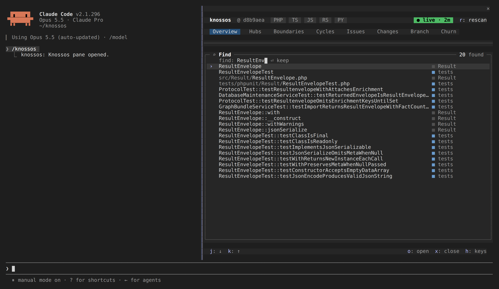

`f` opens the finder over any tab. Type part of a name, or a few words, and it
lists first what `search_architecture` answers the agent: the components every
word matches (in a name, an attribute, a role or a note on the component), else
those most words match, and for a file's path what that file declares. After
those come the other components and files whose name holds the letters in order
(`dsvc` finds `DashboardService`), the closest first, a type before its members,
at most twenty in all. The note says how many were found. Every kind of
component is searched, routes and the kinds an enricher adds among them, except
symbols from outside the project and fields, variables and parameters.

Under the matches, the finder lists the notes on names no component holds that
the words match, each with who wrote it and its first line. A press on one opens
the [Notes tab](#notes) on the missing notes, narrowed to that name.

The search runs after a short pause in the typing. Until its answer lands, the
card says `searching…` and keeps the last matches. Knossos searches on the
first 80 characters of what you type.

| key          | what it does                                                                  |
| ------------ | ----------------------------------------------------------------------------- |
| Enter        | open the marked match (the first one while you type)                          |
| `j` `k`, `o` | move through the matches and open one, when the field does not hold the focus |
| `x`          | close the finder; an empty Enter does too                                     |

A component opens as its detail, a file as the file's. Closing the finder
brings the tab under it back as it was.

## A route between two components

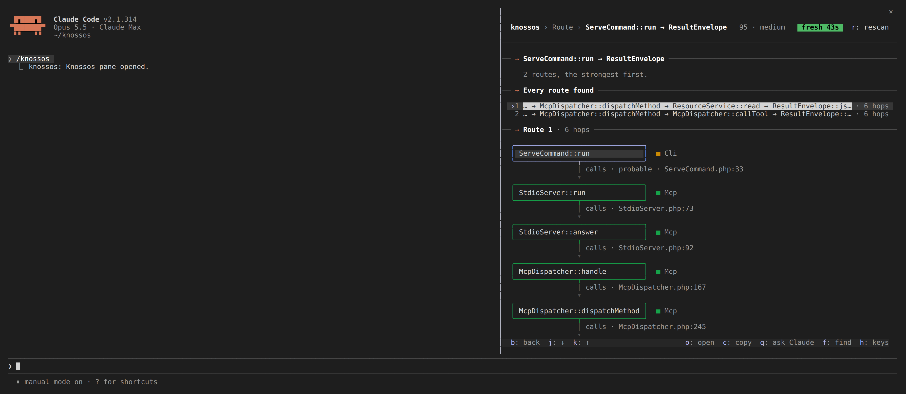

`p` on a component's detail starts a route. The finder opens, offering
components only, and the one you open is where the route ends.

- **The head card** names the two ends and how the search went: `5 routes, the
strongest first.` When only the other direction has a route, the pane draws
  that one and says so in the warning colour.
- **Every route found** lists up to five routes, at most six hops each, every
  one told from the last component they all share (`… → McpDispatcher::dispatchMethod → …`)
  with its hop count. A press on one draws it.
- **Route 1** draws the chosen route as boxes down the pane, each framed in its
  boundary's colour with the boundary beside it. Each hop is an arrow labelled
  with its kind and the file and line it is written at (`calls ·
ServeCommand.php:33`). A hop that is only probable says so, and a hop no edge
  holds, a call to an interface method landing on the method that implements
  it, is drawn dotted and labelled `implemented_by · probable · derived`.

`o` opens a box's component. `b` goes back to the detail the route began on.

## Blast radius

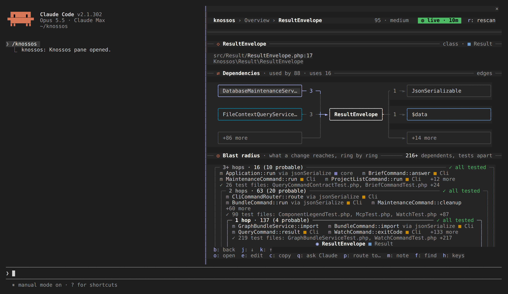

A component's detail draws its blast radius: what depends on it one hop away,
two hops away, and further, as concentric frames with the furthest ring
outermost and the component in the middle. The card's note says how many
dependents there are in all, `tests apart`, since a test is no member of a
ring.

Each frame's top edge carries its hop and how many components it holds
(`2 hops · 53`, and `53 (12 probable)` when some of them depend on it only
probably, through an interface or a property), and on the right either `✓ all tested` or how many no test
reaches (`▲ 1 untested`, in the warning colour). The rings are impact
analysis's own dependants, the answer the agent gets from `impact_analysis`:
the walk starts from the component's members too, so a caller of a static
method counts, and a framework hook (a model's `newFactory`) is depended on by
whatever uses its class. A component counts as tested when a test depends on
it, directly or through others the walk found. The tests are looked for four
hops past the last ring, so a component near the edge counts as tested when its
test stands a little further out, and each component no such test reaches gets
a search of its own.

A call through an interface or a parent class counts for every implementation
of it, constructing a class counts for its constructor, and using a class counts
for its properties, as impact analysis counts them.

Tested means a static path from a test: code a test reaches only at runtime
reads as untested even when coverage counts it. That covers a worker a test
runs as a separate process, a script it includes by a computed path, and a
reader picked from a table of class names.

Inside each frame, before the next ring in:

- its components, the untested first, each after a `▲`; a boundary is named
  only where it differs from the component's own (`http-router.php ■
composer:knossos`);
- `+14 more` for the rest;
- the test files that reach the ring, nearest first (`✓ 19 test files:
McpTest.php, SessionChangesServiceTest.php +17`).

The rings stop at six hops, 1,500 components or two seconds, and the tests'
search at ten hops; the `+` after the count means a bound cut the walk. Every named
component is a row the marker walks, after the detail's dependencies, and `o`
opens it as its detail. Below 44 columns the rings are plain lists.

## A note on a component

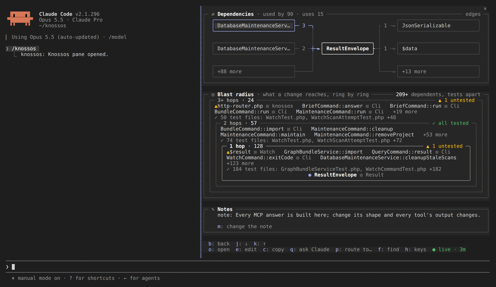

`m` on a component's detail adds a note to it, as the `note` kind of the
`annotate_component` tool does. A note is for a fact the next session should
know and cannot see by reading the code (see
[the routing skill](skill.md#writing-a-fact-back)). A note written here is
yours: it is recorded with the author `user`, which an agent's note never
overwrites.

1. A field opens in the **Notes** card, holding the component's note when it
   has one. Nothing is written by typing.
2. Enter has knossos check the note without writing it. An empty field drops
   it.
3. The card asks `Record this note on ResultEnvelope? "…"`, and says what it
   replaces.
4. Only `y` (or the `record` button) writes it; `n` cancels.

A refusal, such as an ambiguous name or a note over 2,000 bytes, is said in the
card: `✗ knossos did not record it: …`. A note that meets a scan's commit stays
at the question with its text, and the footer says to try again in a moment.
Once recorded, the detail is read again so the note shows, and the button reads
`m: change the note`.

## The diff since the session began

A file opened from Changes also shows how it changed since the session began,
as in the right-hand side of the [Changes still](#changes). The diff is taken
against the commit the project was at when the session started, so it covers
the commits made during the session and the working tree alike.

- An added file shows whole as added, a deleted one whole as removed, and a
  file git moved as the rename, with the other path named.
- The card's note counts the lines added and removed.
- A hunk longer than 40 lines is folded with how many lines are left out.
  Past twelve hunks, or about 24,000 characters, the rest are counted instead.
  Lines longer than 200 characters are cut.
- `N more lines` under a folded hunk is a button: pressing it shows the whole
  hunk. A hunk longer than the diff element takes (10,000 characters) shows
  as much as fits and ends in `N more lines: too long to draw here, e opens the
file`.
- `N more changes further down the file` is a button too: it shows the next
  hunks in place of these, and `N earlier changes` above them goes back. The
  detail shows at most twelve hunks, or about 24,000 characters, at a time.
- What you opened is kept while the detail shows that file. Opening the file
  again, or a new scan that reads its diff again, starts it folded.
- On a wide pane, beside a tab, the diff is drawn as text lines in the added
  and removed colours, at most four hunks of twelve lines. Its last row, `open
the full diff`, opens the file's detail, the same as `o`. Opened on its own,
  the diff uses Claude Code's own diff element, with line numbers and markers.
- The detail scrolls over every line of the diff. Focus the pane, then use the
  wheel, the arrows or Page Up and Page Down; the key bar stays at the bottom.
  Tab and Enter reach the diff's buttons as well as a click does.

With no git repository, no commit yet, a commit that is gone, a binary file
or no answer, the card says which instead of a diff.

## Drifted files

When files changed since the snapshot, the `drifted` tile counts them and `d`
lists them under the tabs, on any tab: each marked `+` added or `−` deleted,
with its boundary, the first twenty by path and how many more. `o` opens a
file's detail as the snapshot holds it, `e` opens the file. `d` again, or a
tab, hides them.

```text
Drifted since the snapshot                                 3
›  hooks/lib/changes.ts                            hooks
 + hooks/lib/files.ts
   src/Query/DashboardService.php                  core
```

`r: rescan` sits beside the pill whenever no scan is running, whatever the
pill says. On a narrow pane the label is the first thing to give way, before
the reason beside the pill; `r` still rescans. It runs an incremental scan under the same rules as a turn's, with
`scanning…` and the age of the figures on show meanwhile. A rescan that fails
turns the pill to `● scan failed`, says why beside it, and keeps the figures.

## Toasts for new cycles and violations

When a scan brings a dependency cycle or a policy violation the graph did not
hold before, the mod says so in a toast, once per cycle or violation a
session:

```text
knossos: a new dependency cycle of 3: Router → Handler → Store → Router
knossos: a new policy violation (domain-isolation): Order → Db
```

A toast compares two snapshots of the same project, never the first graph a
session sees. A scan that brings more than three says the rest as one line:
`knossos: and 4 more new cycles or violations; the Issues and Cycles tabs list
them`. When the graph before the scan listed fewer cycles or violations than it
counted, only the count that grew is said. The `notifications` setting turns
these off.

## No graph yet

With no figures to draw, the pane says which of three things is the case:

| heading                     | meaning                                                                        |
| --------------------------- | ------------------------------------------------------------------------------ |
| `Reading the graph…`        | the first load is on its way                                                   |
| `Could not read the graph`  | knossos did not answer, or answered with an error; it retries every 15 seconds |
| `No architecture graph yet` | knossos answered that it never scanned this project                            |

Only the last offers `q: ask Claude to scan it`. Your press submits:

```text
Scan this project with Knossos (scan_project), then give me a short summary of its architecture.
```

The press checks again before it sends anything, so a habitual `q` during a
slow first load sends nothing. The pane looks for the graph again at the end
of every turn until it finds one.

When the project's root is not allowed, the pane offers `a: allow root`
instead. That only asks: it shows the root it would allow, with `y: allow` and
`n: cancel`. Only `y` runs `knossos allow-root <root> --execute`, against the
roots file the installation names, and then scans the edits the refusal held
back. A grant that fails says why and can be asked again.

## The live watcher

Once a session has the dashboard of an allowed, scanned project, the mod starts
`knossos watch <project> --shared` and keeps it for the session's life. The
watcher polls the project and rescans what changed, whoever changed it. Each
scan it finishes reloads the pane.

- **One watcher per project.** Sessions that share a data directory share one
  watcher per project. The first leads; the others follow, scan nothing, and
  reload their panes when the leader's scan moves the graph. A crashed leader
  never blocks the project: the next follower takes over. The details are in
  [watch mode](../operate/watch-mode.md#shared-mode).
- **Only an existing project.** It watches only a scanned project inside an
  allowed root, and never creates a database.
- **Stopping.** The watcher ends with the session and with a reload of the
  mod, and stops itself once the process that started it is gone. One that
  ends on its own is started again after 30 seconds, then 60, then 90. After
  three restarts in a row it stays off; the count starts over once a watcher
  comes up and leads or follows. A container install runs the watcher in a
  container of its own, attached to the docker client, so it stops when the
  client is stopped or goes away.
- **Stuck scans.** Each scan may run five minutes. Past that it is stopped,
  and killed three seconds later. A follower reports the leader as stuck when
  its heartbeat is more than a minute old.
- **The turn's brief.** The brief after a turn still runs. With a watcher
  running it waits for the watcher to take in the turn's last edits, then
  reads them from the graph instead of scanning again.

Between scans the watcher compares file stats instead of hashing every file,
and fingerprints the whole tree once a minute or when a stat moved. Each scan
runs in a process of its own, so the memory it peaks at goes back when it ends.

## Settings

The settings appear in Claude Code's plugin configuration under the plugin's
name:

| setting           | default                 | what it does                                                                |
| ----------------- | ----------------------- | --------------------------------------------------------------------------- |
| `enabled`         | `true`                  | turns the band, the notes and the pane on or off                            |
| `fanInThreshold`  | `20`                    | dependent files at which a Read or an edit gets a note, 1 to 100,000        |
| `agentNotes`      | `true`                  | gives the model its [notes](agent-notes.md); the toast on an edit stays     |
| `enforcePolicies` | `true`                  | tells the model about violations a turn introduced                          |
| `openPaneOnStart` | `false`                 | opens the pane when a session starts                                        |
| `watch`           | `true`                  | runs the live watcher                                                       |
| `watchPollMs`     | `1000`                  | how often the watcher looks for changes, 250 to 60,000 milliseconds         |
| `notifications`   | `true`                  | toasts each new cycle or policy violation a scan brings, once               |
| `editor`          | `code -g {file}:{line}` | the command `e` and a click on a place run, `{file}` and `{line}` filled in |

## What it writes

The mod writes to the graph in three ways, and nothing else:

- After a turn that edited files with Edit, Write or NotebookEdit, it runs
  `knossos turn-brief`, an incremental scan of the project. A turn that only
  ran shell commands does not start one; the next scan picks those changes up.
- `r` runs `knossos rescan`, the same scan without the brief.
- The live watcher runs incremental scans as files change.

Each of these records what it changed in the scan ledger. They run only for a
project already scanned inside an allowed root, never inside a hook, and never
two at a time within a session. The watcher also writes its lock and state
files under `watch/` beside the database.

Two writes need your confirmation first: allowing a root writes the roots
file, and a note writes one row of annotations. The dashboard keeps its
computed figures for each retained snapshot in a cache table, as every caller
of the trend query does. None of them ever creates a database.

## When it stays silent

- No `knossos` binary on the path or in the usual locations (see
  [the plugin page](plugin.md#the-hooks-need-a-knossos-binary)). The wrapper
  answers `no-binary`, the mod writes one log line, and the band and the pane
  turn off for the session.
- The project is not inside an allowed root: the band names the root instead
  of figures.
- The project has never been scanned.
- An older Claude Code without function hooks ignores the module; the session
  brief keeps working.

Every other failure is silent by design. The band keeps its last figures with
their real age, and a timeout or an empty answer is asked again at the next
turn that edited files.

Paths are compared after symbolic links are resolved, so a checkout you open
through a linked directory is still recognised as the project.

Each call through the wrapper is bounded: 60 seconds for `turn-brief` and the
rescan, 30 for `dashboard` and `branch-diff`, and 15 for the rest. The watcher
is not bounded; it lives as long as the session.

How the mod is built, from the port it reaches Claude Code through to the
tests that keep the pane within the engine's limits, is in
[how the mod is built](../contribute/mod-internals.md).
