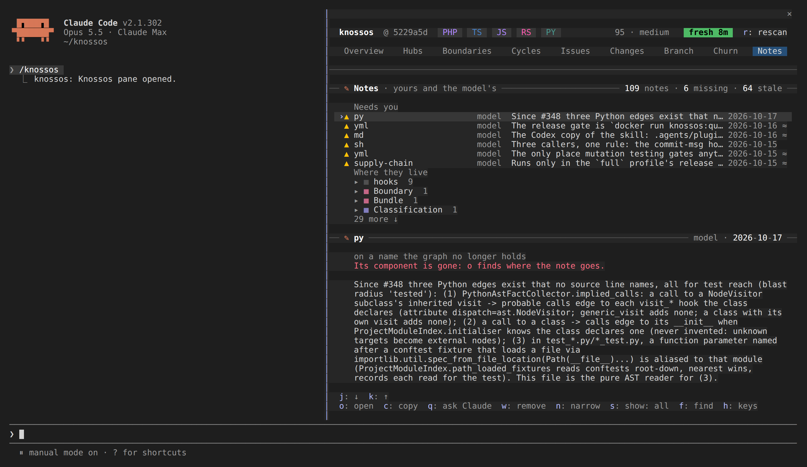

# Notes on components

Notes are facts about a component worth keeping: yours, written in the pane, and
the model's, written through the MCP server. The Notes tab lists them all; `m`
on a component's detail writes one.

How an agent writes, reads and confirms them through the MCP server is in
[component annotations](../../agents/agent-integration.md#component-annotations).

## Notes

The Notes tab is every note in the project, yours and the model's, as a tree of
where each lives, with the ones that need you first.

**Needs you** lists a note on a name the graph no longer holds (`▲`: its
component was renamed or moved, and the note sits on the old name) and a model
note you flagged for the model (`?`). They stay in the tree as well.

**The tree** below it has a row for each boundary (its swatch, its name and how
many notes it holds), the folders inside it, and their notes. The boundary
holding the newest note starts open and the rest folded; folders start open. `o`
on a boundary or a folder folds or unfolds it, and a boundary stays as you left
it when a newer note lands elsewhere. A note on no file sits under its boundary
without a folder. A note's row names its component
(a file note by its path), who wrote it (`you` or `model`), its kind when it is
not a plain note, the first line of its text and the day it was written; a stale
model note, one whose component's own lines changed since it was written
(an edit elsewhere in the same file does not count), ends in `≈`. The
card's note counts them: `142 notes · 3 missing · 5 stale · 1 flagged`.

**Under the tree**, the marked note whole: where it lives (its file and
boundary), who wrote it and when, why it needs a look, and its text.

`n` narrows the tree by text (part of a name or of a note; Enter keeps it), and
marks the hit in each note's first line. `s` shows every note, yours, the
model's, the stale, the missing or the flagged in turn, and `x` clears both.
While either narrows the tree, every group is open so every match shows. On the marked note:

| key | what it does                                                                                                                                                                                                          |
| --- | --------------------------------------------------------------------------------------------------------------------------------------------------------------------------------------------------------------------- |
| `o` | open its component's detail; on a note on a missing name, open the finder on the old name to pick where it belongs                                                                                                    |
| `m` | edit your note, or adopt the model's: the detail opens with its text in the editor, and saving writes it as yours                                                                                                     |
| `w` | remove it, yours or the model's, after asking                                                                                                                                                                         |
| `g` | flag the model's note for the model to check, with a reason if you give one; on a flagged note, take the flag back                                                                                                    |
| `v` | on a stale plain model note: it is still true. It rests on its files as they are now (a cited file that is gone drops out); its text, date and flag stay. A note that rests on no file has nothing to confirm against |

A note you adopt is yours: it wins over the model's and never goes stale, and
the model's stays beside it. Picking a component in the finder for a note on a
missing name asks `Move the note on App\Gone to App\Adapter?`; `y` moves it.
The note keeps its text, evidence and date, and what it was written against, so
a moved model note reads stale until the model looks again. A check you set on
it moves with it. The model can move its own note the same way with
`move_to`, and the lost note's row in `list_annotations` suggests a target
when one component fits. A move to a component that already holds a note by
the same author is refused, and nothing is written.

A flag reaches the next session: its brief says
`The user asked you to check 1 note: App\Target`, and the model's next note on
that component clears it. Removing the last note on a component takes its flag
with it.

A write that meets a scan's commit keeps your question, or your typed note, and
the footer says `a scan is committing; try again in a moment`.

## A note on a component

`m` on a component's detail adds a note to it, as the `note` kind of the
`annotate_component` tool does. A note is for a fact the next session should
know and cannot see by reading the code (see
[the routing skill](../skill.md#writing-a-fact-back)). A note written here is
yours: it is recorded with the author `user`, which an agent's note never
overwrites.

1. A field opens in the footer, holding the component's note when it has one,
   so it is on screen however long the detail and wherever it is scrolled.
   Nothing is written by typing.
2. Enter has knossos check the note without writing it. An empty field drops
   it.
3. The footer asks `Record this note on ResultEnvelope? "…"`, and says what it
   replaces.
4. Only `y` (or the `record` button) writes it; `n` cancels.

A refusal, such as an ambiguous name or a note over 2,000 bytes, is said in the
card: `✗ knossos did not record it: …`. A note that meets a scan's commit stays
at the question with its text, and the footer says to try again in a moment.
Once recorded, the detail is read again so the note shows in the **Notes**
card, and its button reads `change the note`.
