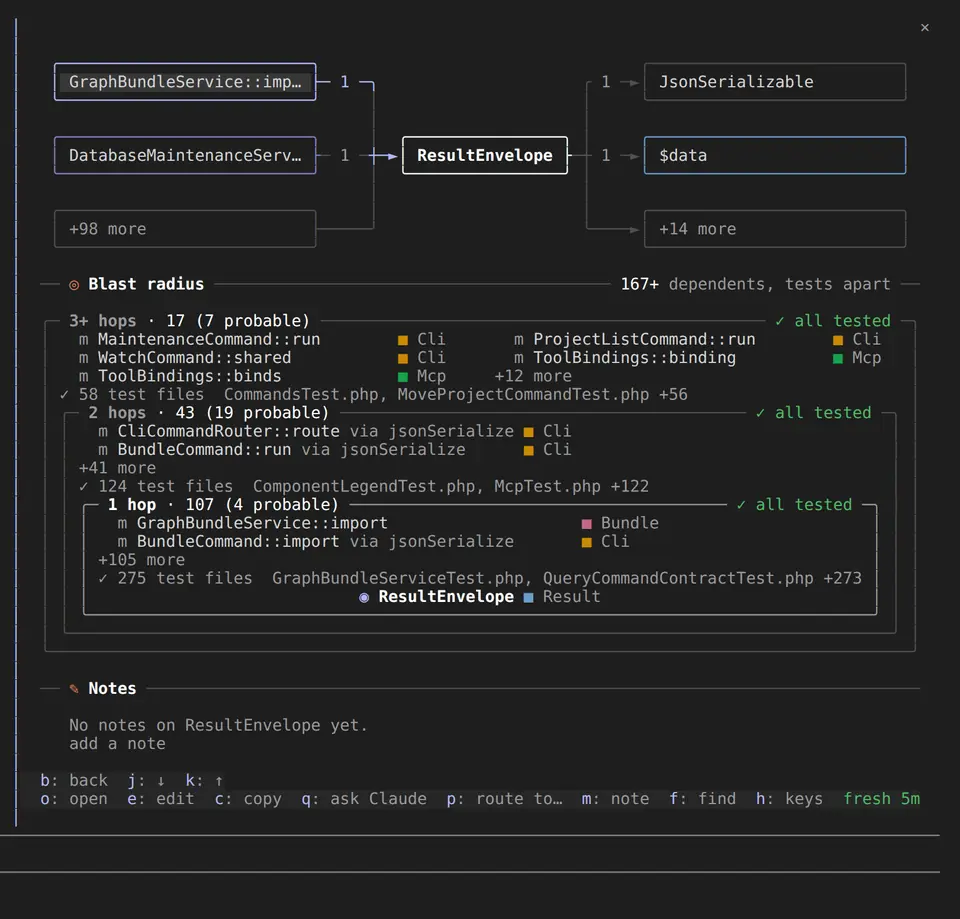
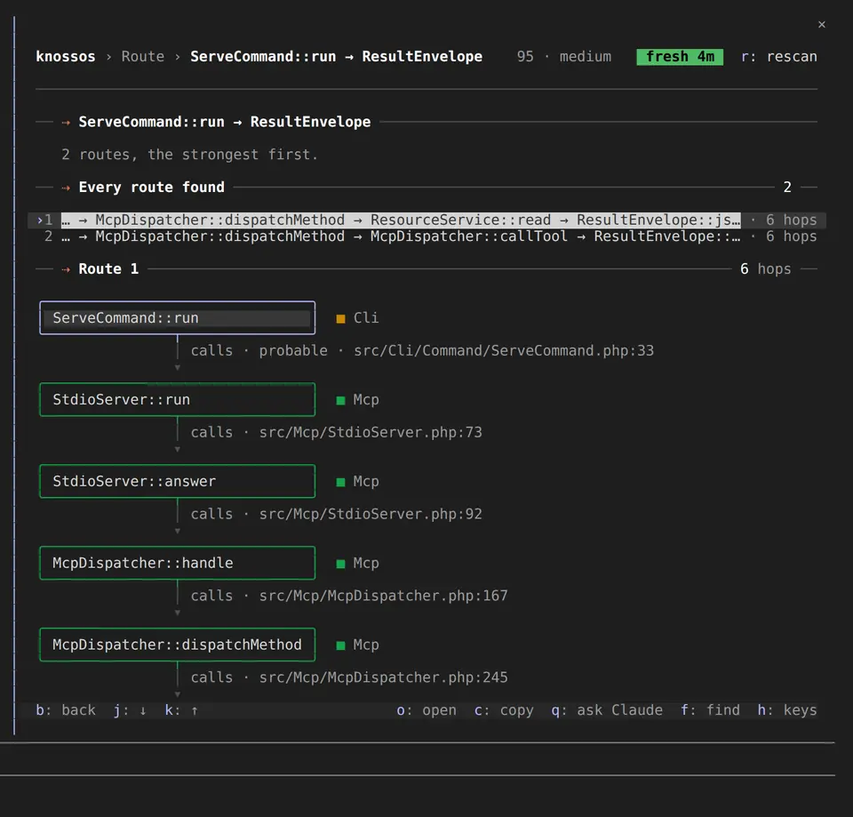
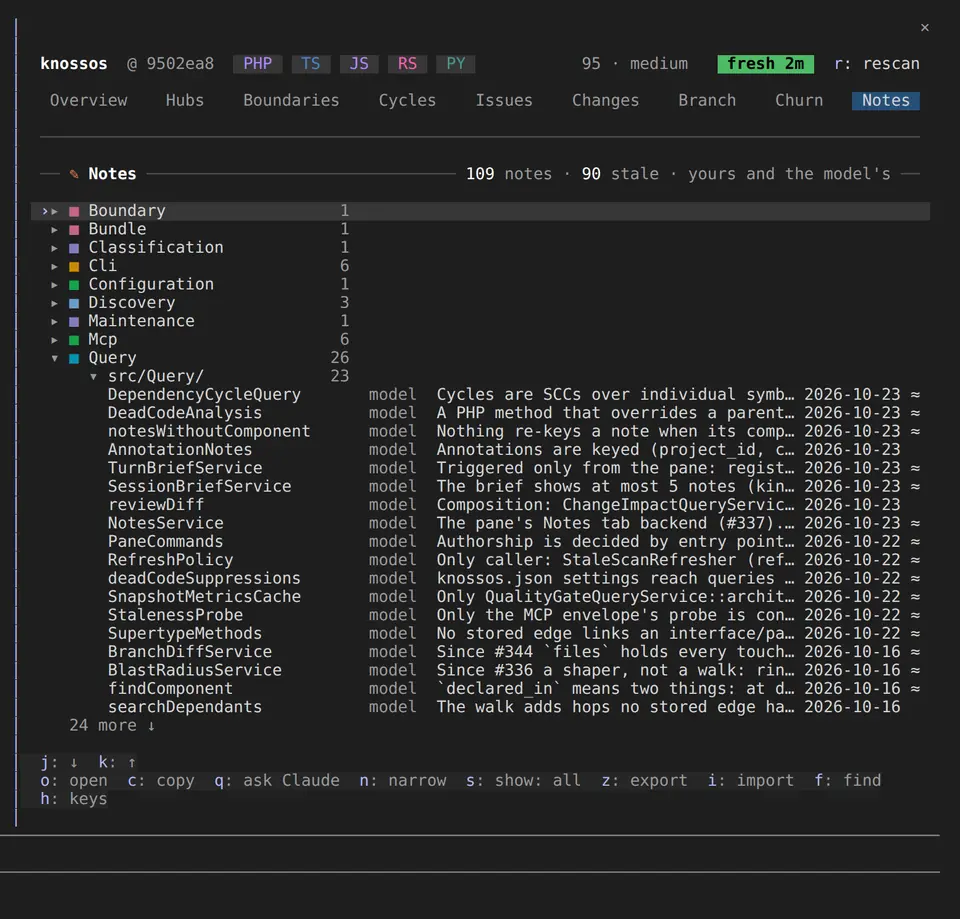
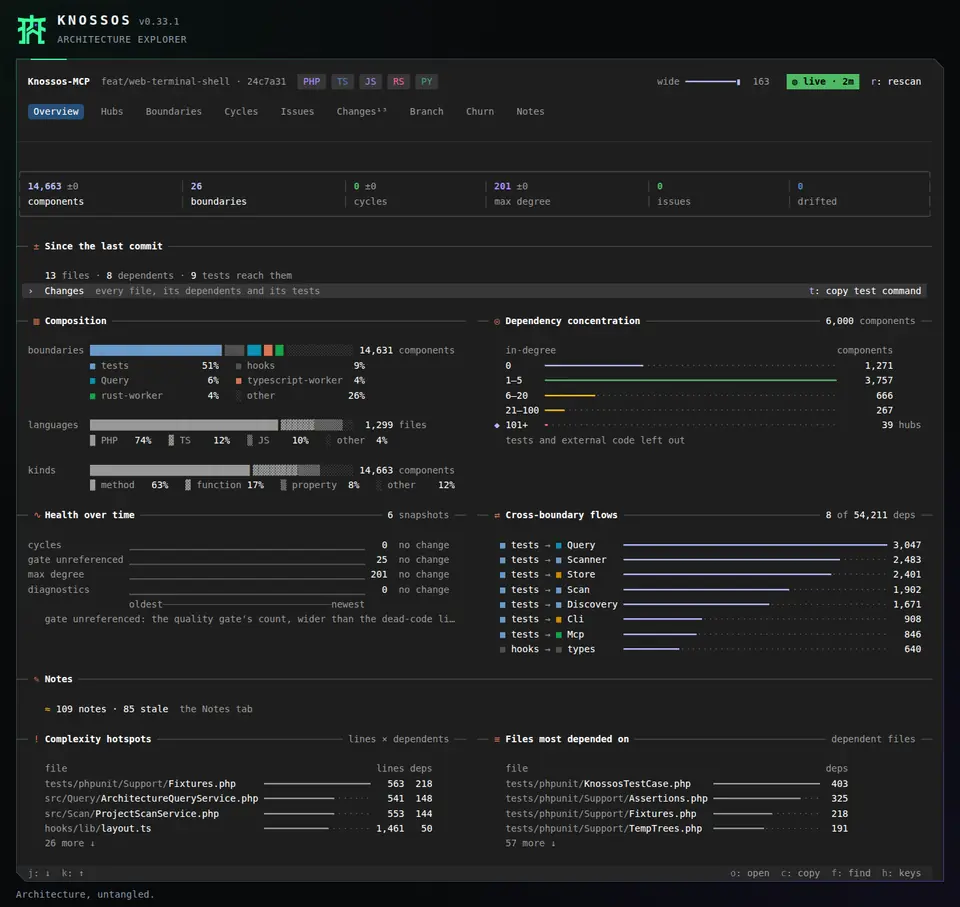

<script setup>
// The page shows reduced copies made from the screenshots in docs/images (see
// website/.vitepress/theme/images); a press opens the screenshot itself.
import heroAnimation from "./images/claude-code/hero.gif";
import overview from "./images/claude-code/overview.png";
import overviewLight from "./images/claude-code/overview-light.png";
import rings from "./images/claude-code/rings.png";
import route from "./images/claude-code/route.png";
import notes from "./images/claude-code/notes.png";
import webClient from "./images/web-client/overview.png";
</script>

<div class="kn-frame">


</div>
<div class="kn-caption">
<span>/knossos opens the pane beside the session. This is the Overview of the Knossos repository.</span>
<a :href="heroAnimation" data-viewer="Claude Code with the Knossos pane: /knossos opens it, the tabs pass by, the finder opens ResultEnvelope's blast radius, then the band sums up a turn">Watch it open (animated, 1.2 MB)</a>
</div>

Knossos scans a repository into a local graph of its components and the relationships between them, each with the file and line that proves it. In Claude Code, `/knossos` opens that graph as a live pane beside your session, and the same graph answers 40 MCP tools and a CLI for Claude Code, Codex or any MCP client.

Facts that static analysis cannot prove are labelled with their confidence and origin. Nothing in the scan installs dependencies, imports a module or boots a framework.

## What the pane shows

<div class="kn-tiles">
<div class="kn-tile">
<div class="kn-tile-title"><span class="glyph">◎</span>Blast radius</div>

<p>What a change to one component reaches, ring by ring, and whether a test reaches each ring.</p>
<a class="kn-more" href="./claude-code/pane/details#blast-radius">Details and blast radius</a>
</div>
<div class="kn-tile">
<div class="kn-tile-title"><span class="glyph">→</span>Routes</div>

<p>How one component reaches another, every hop with the file and line it is written at.</p>
<a class="kn-more" href="./claude-code/pane/details#a-route-between-two-components">Routes between components</a>
</div>
<div class="kn-tile">
<div class="kn-tile-title"><span class="glyph">✎</span>Notes</div>

<p>Facts you and the model keep about components, filed by where they live, with the ones that need you first.</p>
<a class="kn-more" href="./claude-code/pane/notes">Notes on components</a>
</div>
<div class="kn-tile kn-tile-web">
<div class="kn-tile-title"><span class="glyph">■</span>In a browser</div>

<p>The same pane in a browser tab with <code>knossos web</code>, for one project and no Claude Code session around it.</p>
<a class="kn-more" href="./guides/web-pane">The pane in a browser</a>
</div>
</div>

## Install

A native install needs PHP 8.3 or newer with the JSON, mbstring, PDO, PDO SQLite and tokenizer extensions, Node 24 or newer, Python 3.11 or newer and Git, and `knossos doctor` fails without any of them. On a host with Docker or Podman instead, the installer runs Knossos in a container. This installs the latest release:

```sh
curl -fsSL https://github.com/AraneaDev/knossos/releases/latest/download/install.sh | sh
```

The installer grants the folder you run it from to the list of projects Knossos may scan, except `/` and your home folder when you pipe it as above; set `KNOSSOS_ALLOW_ROOT` to grant another folder, or pass `--no-roots` to grant none. [Installation](get-started/installation.md) covers installing from a checkout or in Docker, and what to do when it does not start.

## Where to go next

- [Install Knossos](get-started/installation.md): register it with Claude Code or another MCP client.
- [Scan your first project](get-started/first-scan.md): scan a project, check the result and see what an answer looks like.
- [The pane](claude-code/pane/index.md): open it beside your session and read its tabs.
- [MCP tool reference](reference/mcp-tools.md): what each tool takes and returns.
- [The graph and its evidence](concepts/graph-and-evidence.md): what a scan stores and how far you can trust each fact.
- [All pages](README.md): every page, grouped by the question it answers.
